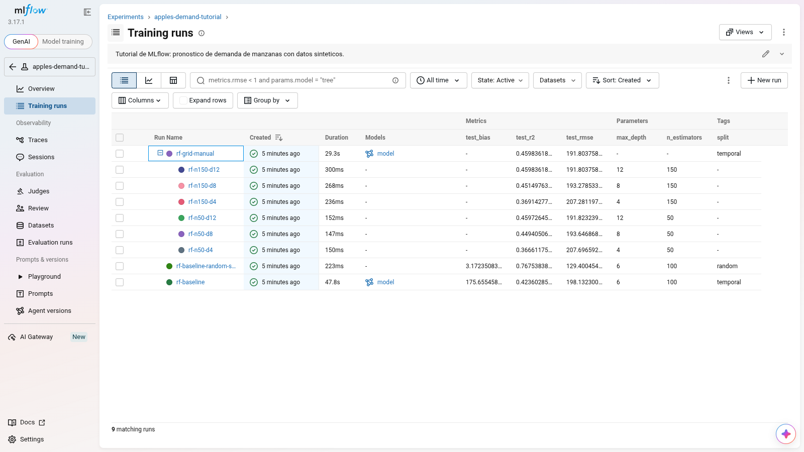
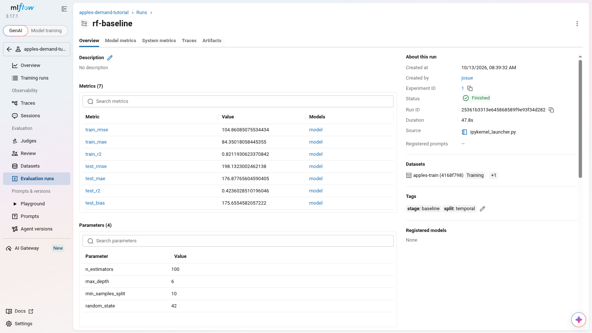
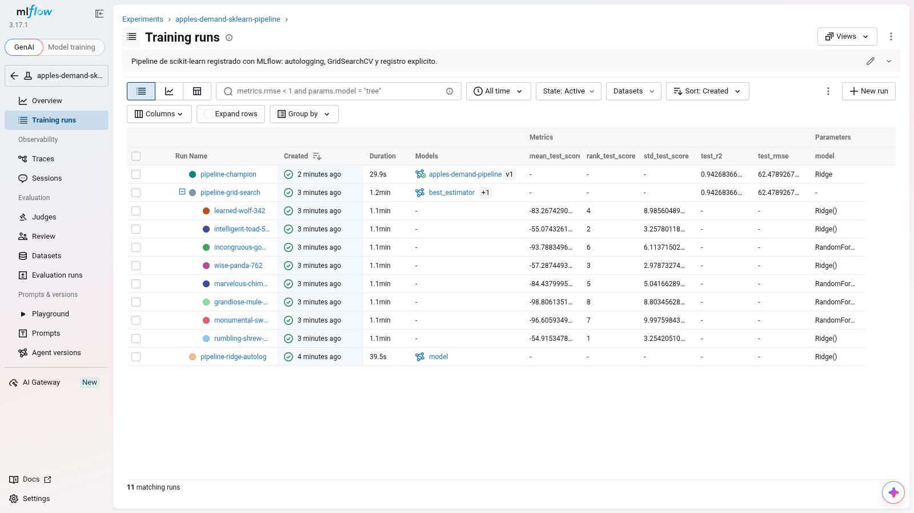
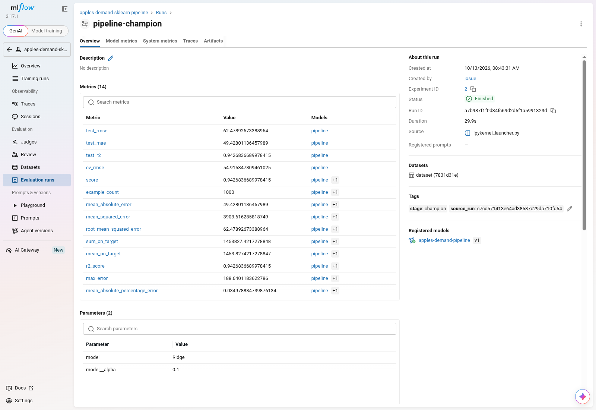
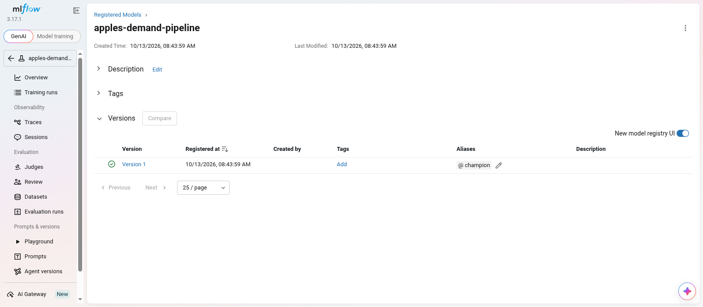

# Actividad 4: Seguimiento de experimentos con MLflow

Taller para aprender **MLflow** y cómo se integra con **scikit-learn**, con CRISP-DM como
referencia metodológica.

## Descripción

El taller pide tres cosas, y cada una tiene su documento o su notebook:

| # | Punto del taller | Dónde está |
| :--- | :--- | :--- |
| 1 | Recorrer la documentación de MLflow, elegir tres páginas y explicar por qué | [`docs/01_mlflow-top.md`](docs/01_mlflow-top.md) |
| 2 | Seguir el tutorial de MLflow en un notebook y analizar el generador de datos sintéticos | [`notebooks/01_mlflow-tracking-tutorial.ipynb`](notebooks/01_mlflow-tracking-tutorial.ipynb) y [`docs/02_synthetic-data-review.md`](docs/02_synthetic-data-review.md) |
| 3 | Conectar MLflow con un `Pipeline` de scikit-learn, siguiendo la sección de la documentación que lo explica | [`docs/03_sklearn-pipeline-review.md`](docs/03_sklearn-pipeline-review.md) y [`notebooks/02_mlflow-sklearn-pipeline.ipynb`](notebooks/02_mlflow-sklearn-pipeline.ipynb) |

## Entregables

| Entregable | Dónde está |
| :--- | :--- |
| Enlace al repositorio | <https://github.com/JosueSay/ml-engineering-portfolio/tree/main/workshop/activity-04-mlflow-tracking> |
| Capturas de pantalla con métricas registradas por MLflow | [Capturas](#capturas-de-mlflow) |
| Notebook con MLflow y un pipeline de scikit-learn | [`notebooks/02_mlflow-sklearn-pipeline.ipynb`](notebooks/02_mlflow-sklearn-pipeline.ipynb) |
| Conclusiones y posibles usos | [`docs/04_conclusions.md`](docs/04_conclusions.md) |

## Estructura

```bash
activity-04-mlflow-tracking/
├── docs/
│   ├── 01_mlflow-top.md                  # Páginas elegidas de la documentación y por qué
│   ├── 02_synthetic-data-review.md       # Análisis del generador de datos del tutorial
│   ├── 03_sklearn-pipeline-review.md     # Análisis del código que conecta MLflow con un Pipeline
│   ├── 04_conclusions.md                 # Conclusiones y posibles usos
│   └── images/                           # Capturas de la interfaz de MLflow
├── notebooks/
│   ├── 01_mlflow-tracking-tutorial.ipynb # Tutorial: seguimiento manual y ejecuciones anidadas
│   └── 02_mlflow-sklearn-pipeline.ipynb  # Pipeline, autologging, GridSearchCV y registro
├── src/
│   └── mlflow_workshop/
│       ├── __init__.py                   # Exporta los símbolos públicos
│       ├── tutorial_data.py              # Generador del tutorial, sin modificar
│       ├── synthetic_data.py             # Generador mejorado
│       └── pipeline.py                   # Transformador propio, pipeline y métricas
├── pyproject.toml                        # Dependencias y configuración del paquete
├── uv.lock                               # Versiones exactas del entorno
└── README.md                             # Este archivo
```

El almacén de MLflow (`mlflow.db` y `mlartifacts/`) se crea al ejecutar los notebooks y no
se versiona.

## Instalación

Los notebooks importan el paquete `mlflow_workshop`, así que hay que instalarlo.

### Con uv

```bash
git clone https://github.com/JosueSay/ml-engineering-portfolio.git
cd ml-engineering-portfolio/workshop/activity-04-mlflow-tracking

uv sync
```

`uv sync` crea `.venv`, instala las versiones de `uv.lock` y deja el paquete en modo
editable.

### Con pip

```bash
python3 -m venv .venv
source .venv/bin/activate        # En Windows: .venv\Scripts\activate

pip install -e .
```

## Uso

### Ejecutar los notebooks

En Visual Studio Code, abrir cada notebook y elegir `.venv` como kernel. Desde la terminal,
en orden:

```bash
uv run jupyter nbconvert --to notebook --execute --inplace notebooks/01_mlflow-tracking-tutorial.ipynb
uv run jupyter nbconvert --to notebook --execute --inplace notebooks/02_mlflow-sklearn-pipeline.ipynb
```

Cada ejecución agrega ejecuciones nuevas al almacén. Para empezar de cero, borrar
`mlflow.db` y `mlartifacts/`.

### Abrir la interfaz de MLflow

Desde la raíz de la actividad:

```bash
uv run mlflow ui --backend-store-uri sqlite:///mlflow.db --port 5000
```

La interfaz queda en <http://127.0.0.1:5000>.

## Capturas de MLflow

### Ejecuciones del tutorial y sus métricas

Experimento `apples-demand-tutorial`: las dos ejecuciones base, que solo difieren en la
partición, y la búsqueda manual con sus seis ejecuciones hijas.



### Detalle de una ejecución

Ejecución `rf-baseline`: parámetros, métricas de entrenamiento y de prueba, etiquetas y
conjuntos de datos registrados a mano.



### GridSearchCV con autologging

Experimento `apples-demand-sklearn-pipeline`: la ejecución padre de `GridSearchCV` y una
hija por combinación, creadas por `mlflow.sklearn.autolog()` sin código de registro.



### Métricas del pipeline ganador

Ejecución `pipeline-champion`: métricas de prueba registradas a mano junto a las que
calculó `mlflow.models.evaluate`.



### Modelo registrado

Model Registry: el pipeline registrado como `apples-demand-pipeline`, con su versión y el
alias `champion`.



## Resultados

Datos: 5,000 días sintéticos. Entrenamiento con los primeros 4,000 y prueba con los
últimos 1,000.

| Ejecución | Modelo | Partición | RMSE prueba | $R^2$ prueba |
| :--- | :--- | :--- | :--- | :--- |
| `rf-baseline-random-split` | Bosque aleatorio sobre columnas crudas | Aleatoria | 129.40 | 0.768 |
| `rf-baseline` | Bosque aleatorio sobre columnas crudas | Temporal | 198.13 | 0.424 |
| `rf-grid-manual` | Mejor bosque de la rejilla manual | Temporal | 191.80 | 0.460 |
| `pipeline-grid-search` | Pipeline con `Ridge(alpha=0.1)` | Temporal | 62.48 | 0.943 |

Dos lecturas:

- La partición aleatoria del tutorial hace parecer bueno a un modelo que no lo es: al pasar
  a la temporal, el mismo bosque cae de $R^2 = 0.768$ a $0.424$ y se queda corto en el 98 %
  de los días de prueba.
- La mejora grande no viene de ajustar hiperparámetros sino de la preparación de datos: el
  pipeline deriva de la fecha una variable de tendencia y el mes, y con eso un modelo lineal
  supera al bosque. El ruido del generador tiene desviación 50, que es el piso del RMSE para
  cualquier modelo; el pipeline queda en 62.

## API del paquete

### `mlflow_workshop.synthetic_data`

| Objeto | Descripción |
| :--- | :--- |
| `generate_apple_sales_data(n_rows, base_demand, ..., seed, keep_components)` | Genera la serie diaria de demanda. Reproducible y sin nulos |
| `FEATURE_COLUMNS`, `TARGET_COLUMN`, `COMPONENT_COLUMNS` | Nombres de las columnas de entrada, del objetivo y de los aportes de cada factor |

### `mlflow_workshop.pipeline`

| Objeto | Descripción |
| :--- | :--- |
| `DemandFeatures(date_column)` | Transformador que deriva mes, años transcurridos y comparación de precios |
| `build_preprocessor()` | `ColumnTransformer` con ramas numérica, binaria y categórica |
| `build_pipeline(model)` | Pipeline completo: variables derivadas, preprocesamiento y modelo |
| `split_by_time(df, target, test_size)` | Partición temporal: el último tramo queda para prueba |
| `regression_metrics(y_true, y_pred, prefix)` | Dict con `rmse`, `mae` y `r2`, listo para `mlflow.log_metrics` |

### `mlflow_workshop.tutorial_data`

| Objeto | Descripción |
| :--- | :--- |
| `generate_apple_sales_data_with_promo_adjustment(...)` | Función del tutorial de MLflow, copiada sin cambios para poder analizarla. No se ejecuta con pandas 3 |

## Metodología CRISP-DM

| Fase | Qué se hizo | Funcionalidad de MLflow |
| :--- | :--- | :--- |
| Data Understanding | Análisis del generador de datos y de sus defectos | Registro del conjunto de datos con `mlflow.log_input` |
| Data Preparation | Variables derivadas y preprocesamiento dentro del pipeline | Scikit-learn Integration |
| Modeling | Bosque aleatorio, `Ridge` y búsqueda en rejilla con validación cruzada temporal | Experiment Tracking y Autologging |
| Evaluation | Métricas de prueba, sesgo y comparación entre particiones | Experiment Tracking y Model Evaluation |
| Deployment | Pipeline registrado con versión y alias | Model Registry |

## Problemas conocidos

- **El autologging no registra nada y no da error visible.** Pasa si el intérprete de Python
  se compiló sin soporte para `lzma`: MLflow registra el aviso
  `Encountered unexpected error during sklearn autologging: No module named '_lzma'` y la
  ejecución queda sin métricas ni ejecuciones hijas. Se comprueba con
  `python -c "import lzma"` y se resuelve creando el entorno con otro intérprete, por
  ejemplo `uv sync --python /usr/bin/python3.12`.
- **`log_model` falla con tipos no confiables.** MLflow 3 serializa con `skops`. Los modelos
  de árboles y los transformadores propios se declaran en `skops_trusted_types`, como hacen
  los dos notebooks.
- **Ejecutar con `autolog(silent=True)` esconde el primer problema.** Si algo no aparece en
  la interfaz, quitar `silent=True` es lo primero que hay que probar.

## Requisitos

- Python >= 3.11
- mlflow >= 3.0
- scikit-learn >= 1.5
- pandas >= 2.2

Versiones con las que se ejecutó: Python 3.12.13, MLflow 3.17.1, scikit-learn 1.9.1,
pandas 3.0.6 y numpy 2.5.4.

## Autor

Machine Learning Engineering - Universidad del Valle de Guatemala
